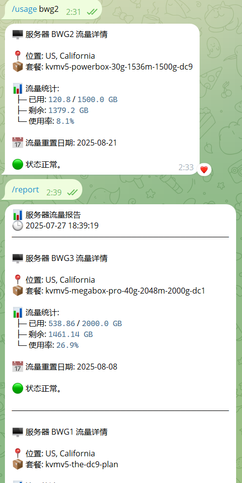

中文版|[English](README.md)


# BWG Bot - 服务器使用监控机器人

一个 Telegram 机器人，通过查询 64clouds API 监控 BandwagonHost (BWG) VPS 服务器使用情况，并在指定的时间自动向配置的 Telegram 群组或用户发送报告。

也支持使用登录 Cookie 查询 DMIT 控制台的套餐流量，复用 `/usage`、`/report` 和自动报告。

## 功能特性

- 📊 **实时服务器监控**：查询单个服务器使用统计信息
- 📈 **自动报告**：定期向多个群组/用户发送使用报告
- 🔍 **多服务器支持**：监控多个服务器，支持不同配置
- 🎯 **灵活通知**：为不同群组配置不同的服务器
- 📅 **灵活调度**：设置每天、每周或每月的具体报告时间
- 🛡️ **错误处理**：全面的错误处理和日志记录

## 机器人命令

- `/usage <服务器名称>` - 查询单个服务器使用统计信息
- `/report` - 生成所有配置服务器的报告
- `/getgroupid` - 获取当前聊天/群组 ID 用于配置

## 效果截图



## 安装步骤

1. **克隆仓库**：
   ```bash
   git clone <仓库地址>
   cd bwgbot
   ```

2. **安装依赖**：
   ```bash
   pip install -r requirements.txt
   ```

3. **配置环境变量**：
   在项目根目录创建 `.env` 文件：
   ```env
   # Telegram 机器人令牌（必需）
   BOT_TOKEN=your_telegram_bot_token_here
   
   # 自动报告调度（可选，默认：daily:09:00）
   # 支持的格式：
   # - 每天：daily:HH:MM（例如：daily:09:00）
   # - 每周：weekly:DAY:HH:MM 或 DAY:HH:MM（例如：MON:09:00）
   # - 每月：monthly:DD:HH:MM 或 DD:HH:MM（例如：06:09:00）
   AUTO_REPORT_SCHEDULE=daily:09:00

   # 机器人启动后立即发送一次自动报告（配置任意非空值启用）
   # AUTO_REPORT_ON_START=1
   
   # 服务器配置（根据需要添加）
   SERVER1_VEID=your_veid_here
   SERVER1_API_KEY=your_api_key_here
   
   SERVER2_VEID=another_veid_here
   SERVER2_API_KEY=another_api_key_here
   
   # 群组配置（可选，用于自动报告）
   GROUP_CONFIG_1=-1001234567890:server1,server2
   GROUP_CONFIG_2=123456789:server1
   ```

4. **运行机器人**：
   ```bash
   python bot.py
   ```

## 配置说明

### 服务器配置

可以到[这里](https://bandwagonhost.com/whmcsExportServiceInfoCsv.php) 获取当前BWG账号下所有VEID和API Key。

对于每个要监控的服务器，需要添加两个环境变量：
- `{服务器名称}_VEID`：来自 BWG 控制面板的 VEID
- `{服务器名称}_API_KEY`：来自 BWG 控制面板的 API 密钥

`服务器名称` 可以是任何你选择的标识符（例如：`US1`、`EU1`、`ASIA1`）。


### 群组配置

要启用自动报告，请配置群组/用户：
- 格式：`GROUP_CONFIG_{N}={聊天ID}:{服务器列表}`
- `{N}`：序列号（1、2、3...）
- `{聊天ID}`：Telegram 群组 ID（负数）或用户 ID（正数）
- `{服务器列表}`：逗号分隔的服务器名称列表

**示例**：
```env
# 向群组发送 server1 和 server2 的报告
GROUP_CONFIG_1=-1001234567890:server1,server2

# 向用户发送 server1 的报告
GROUP_CONFIG_2=123456789:server1
```

### 获取聊天 ID

1. 将机器人添加到群组或开始私聊
2. 发送 `/getgroupid` 命令
3. 复制返回的 ID 到 `.env` 文件中

## API 集成

此机器人使用 64clouds API 获取服务器统计信息。您需要：
1. 从 BWG 控制面板获取 VEID（虚拟环境 ID）
2. 从 BWG 控制面板获取 API 密钥

## 调度示例

### 每日报告
```env
# 每天上午 9:00 发送报告
AUTO_REPORT_SCHEDULE=daily:09:00
```

### 每周报告
```env
# 每周一上午 9:00 发送报告
AUTO_REPORT_SCHEDULE=MON:09:00
# 或
AUTO_REPORT_SCHEDULE=weekly:MON:09:00
```

### 每月报告
```env
# 每月 6 日上午 9:00 发送报告
AUTO_REPORT_SCHEDULE=06:09:00
# 或
AUTO_REPORT_SCHEDULE=monthly:06:09:00
```

**支持的星期**：MON, TUE, WED, THU, FRI, SAT, SUN

### 启动后立即执行一次

将 `AUTO_REPORT_ON_START` 设置为任意非空值，机器人启动后会立即发送一次报告，后续报告仍按照 `AUTO_REPORT_SCHEDULE` 执行。不配置或配置为空时，首次报告也按照原有调度时间执行。

## 使用示例

### 查询单个服务器
```
/usage server1
```

### 生成完整报告
```
/report
```

### 获取聊天 ID
```
/getgroupid
```

## 错误处理

机器人包含全面的错误处理：
- 网络超时保护
- API 错误检测和报告
- 启动时配置验证
- 优雅的失败处理和用户通知

## 日志记录

机器人记录所有活动，包括：
- 配置加载
- API 请求和响应
- 错误条件
- 报告生成和传送

## 系统要求

- Python 3.7+
- Telegram Bot API 令牌
- 具有 API 访问权限的 BWG 账户

## 许可证

此项目是开源的，根据 MIT 许可证提供。

## 贡献

欢迎贡献！请随时提交 Pull Request。

## 支持

如果您遇到任何问题或有疑问，请在仓库中创建 issue。

## 模块与环境变量

- `bot.py`：装配服务器、生成通用报告、处理 Telegram 命令和推送、安排任务。
- `bwg.py`：读取 BWG 环境变量、查询 API、处理额度倍数和重置时间、返回统一报告数据。
- `dmit.py`：读取 DMIT 环境变量、查询控制台只读 JSON、转换 MiB 和 UTC 月度重置日期。

供应商模块都返回 `quota_bytes`（总额度字节数）、`used_bytes`（套餐已用字节数）、`reset_date`（展示日期）、`hostname`（主机名）、`ip_addresses`（地址列表）、`location`（机房说明）、`plan`（套餐说明）。机器人不解析供应商原始字段。

所有参数从环境变量读取；直接启动脚本也会加载 `.env`，已有进程环境变量优先。BWG 保留 `{名称}_VEID`（BWG 虚拟环境编号）和 `{名称}_API_KEY`（该实例 API 密钥）。DMIT 配置示例：

```env
# DMIT 服务记录编号：详情页 URL 的 id，标识账号购买的 VPS 服务，不是宿主机虚拟机编号。
FONTANA_DMIT_SERVICE_ID=116313
# 登录时勾选“记住我”，从本人 whmcsdetail 请求复制 Cookie；必须含 WHMCSUser。
FONTANA_DMIT_COOKIE='在此填写请求 Cookie'
# 从同一请求复制 User-Agent。
FONTANA_DMIT_USER_AGENT='在此填写 User-Agent'
```

不再读取 DMIT 会话 JSON 文件，也不再接受服务编号/凭据文件命令行参数。服务器名为 `fontana`，可查询 `/usage fontana`，或放入现有群组服务器列表。同名服务器不能同时属于两个供应商；配置缺少必要认证参数会阻止启动，不静默跳过。

两个供应商都能独立查询，无需 Telegram Token；会查询环境变量中该供应商的全部已配置实例：

```bash
python bwg.py
python dmit.py
```

成功向标准输出写入按服务器名组织的 JSON，失败退出码为 1；日志写入标准错误，不输出密钥、Cookie、完整请求 URL 或原始响应。部署时通过容器环境变量（或 `--env-file`）注入参数；镜像包含三个脚本，不包含 `.env`。

DMIT 使用权威 `bwusage`，不自行累加上下行，也不使用开机累计流量。MiB 转字节后，报告展示与控制台 GB 数字一致。重置日期依控制台规则按续费日号计算每月 UTC 日期，短月取月底；这不是实际重置执行记录。接口不返回套餐名称和机房，报告显示 `DMIT VPS`、`N/A`。当前支持有配额实例，缺失或无效数据直接报错。

### DMIT 长效 Cookie 与会话维护

本方案接受正常情况下长期运行、认证偶发提前失效时人工更新。

1. 在浏览器登录 DMIT 时勾选“Remember Me／记住我”，必要时手动完成 Cloudflare 验证。
2. 从已登录详情页的 `whmcsdetail` 请求复制 Cookie 和 User-Agent 到对应环境变量。Cookie 必须包含非空 `WHMCSUser`（DMIT 的记住我认证凭据），并保留请求需要的 Cloudflare Cookie；只有临时 WHMCS 会话 Cookie 的配置会被拒绝。
3. 启动机器人。每个 DMIT 实例使用独立 HTTP 会话，自动接收 `Set-Cookie`，后续请求复用更新后的 Cookie，不再反复发送初始旧值。

临时会话保存在进程内，不写回 `.env` 或磁盘。进程重启时重新读取初始长效 Cookie，由 DMIT 的记住我机制建立临时登录会话。运行时不需要登录邮箱或密码，也不依赖 Chromium。

2026-10-15 已实测：勾选记住我后 DMIT 签发约365天的 `WHMCSUser`；删除独立测试客户端中的临时会话 Cookie 后，保留记住我和 Cloudflare Cookie，查询成功并获得新的临时会话 Cookie。365天是客户端过期属性，不保证服务端不会提前撤销。

认证失效、返回登录页或需要 Cloudflare 验证时，`/usage` 查询回复、`/report` 及已配置的定时报告会明确提示：重新登录并勾选记住我，更新 Cookie/User-Agent 环境变量后重启。提示在查询时产生，没有额外监控任务或固定365天倒计时；失败不会显示成零流量。

`cf_clearance` 是独立的 Cloudflare 通行凭据。它或记住我凭据被撤销后仍可能需要人工更新。本机空会话 Chromium 验证已遇到人工挑战，不能承诺全年完全无人干预；运行时不自动登录、不解决人工挑战、不自行获取新的长效 Cookie。部署到不同出口仍需验证 Cookie 是否被接受。

参考：[WHMCS Sessions](https://docs.whmcs.com/8-11/customization/sessions/)、[Cloudflare Challenge Passage](https://developers.cloudflare.com/cloudflare-challenges/challenge-types/challenge-pages/challenge-passage/)。
